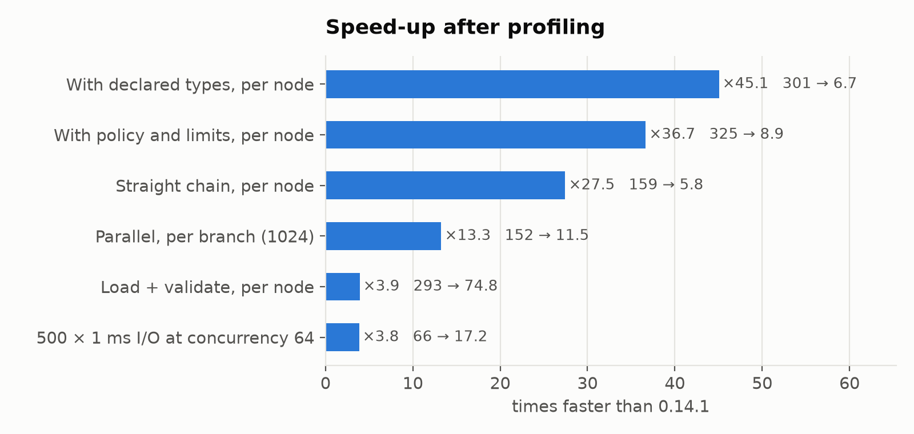
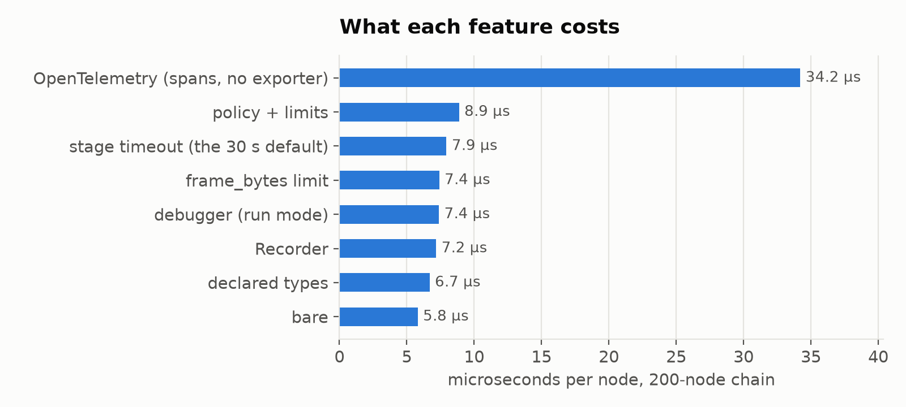
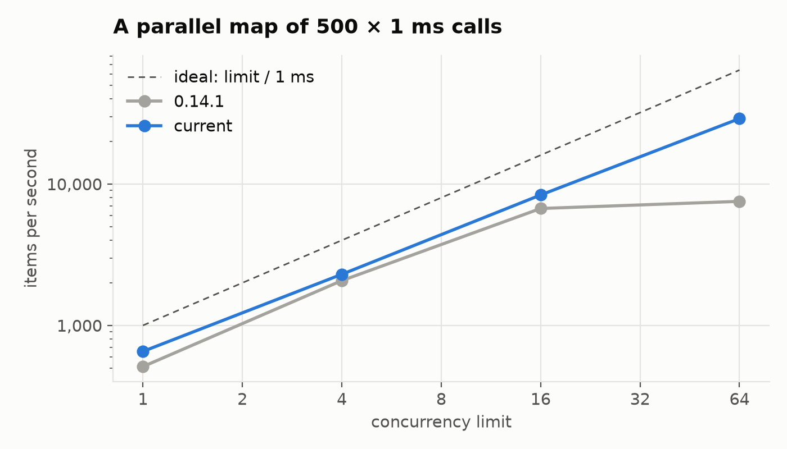
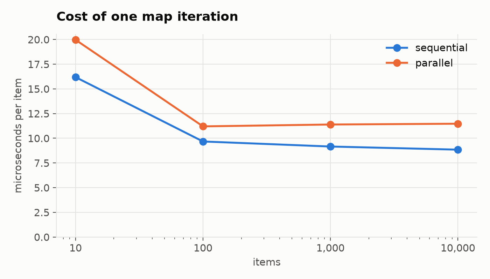
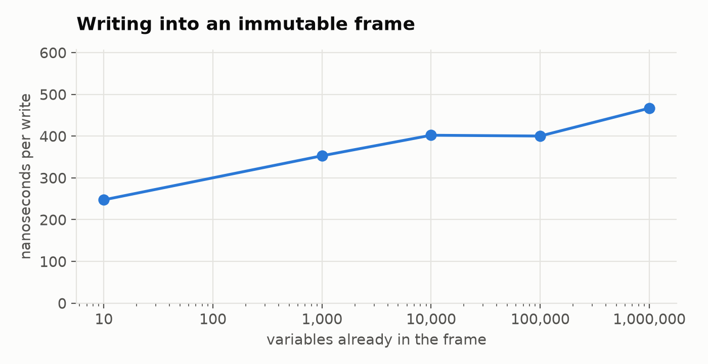
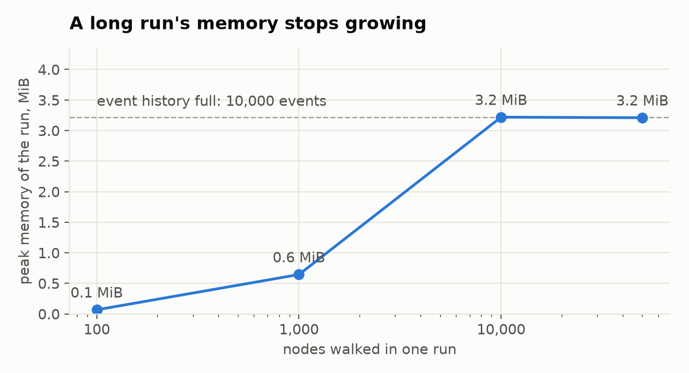

# Benchmarks

```bash
pip install -e ".[test]" matplotlib
python benchmarks/bench.py            # full set, a few minutes → results/results.json, results.md
python benchmarks/bench.py --quick    # smaller sizes
python benchmarks/plot.py             # charts → results/*.png
```

Every number is the median of several repeats after a warm-up, measured with
`time.perf_counter` inside one event loop. The stages do no work of their own
(`BenchNoop` writes its argument back), so what is measured is the framework:
walking the graph, binding arguments and outputs, the budget, the policy.
`BenchIO` waits 1 ms to stand in for a network call.

The numbers below are from an i7-13700KF, Python 3.14, Linux. Absolute values
depend on the machine; the ratios are what to look at. Full tables are in
[`results/results.md`](results/results.md); the 0.14.1 baseline is
[`results/baseline-0.14.1.json`](results/baseline-0.14.1.json).

## What profiling found

The first run of this suite measured about **160 µs per node** on a straight
chain — while the same stage inside a `map` cost 10 µs. Profiling (`cProfile`)
found five causes:

| Problem | Where | Fix |
|---|---|---|
| The YAML in a stage's docstring was parsed again on every `get_specs()` — once per stage node at every validation (and `Session()` validates), and once per stage run whenever limits were set | `core/spec.py` | the parse is cached per docstring; validation and reservations read a small cached `StageContract` (names, types, `reserve`) instead of the full translated card |
| The main loop raced every node against a stop event: two extra tasks and an `asyncio.wait` per node | `Session.run` | the graph is walked in one task; `stop()` cancels it (thread-safe) |
| A stage with a timeout — every stage by default, `BaseStage.timeout = 30` — ran in a task of its own with a polling loop | `Session._run_stage_body` | `asyncio.timeout()` in the current task; idle periods put the timeout on hold with `reschedule()` |
| JSON Schema evaluated nine `if type == … then …` blocks for every node | `Pipeline._check_schema` | valid documents are confirmed by `jsonschema-rs` (Rust); errors are still collected by `jsonschema`, against the shell schema plus one schema per node `type`, so messages and paths are unchanged |
| The cycle check was a recursive DFS: a straight graph of ~1000 nodes raised `RecursionError` | `Pipeline._cycle_errors` | iterative DFS with an explicit stack |



| | 0.14.1 | now |
|---|---|---|
| straight chain | 159 µs/node, 6.3 k nodes/s | **5.8 µs/node, 172 k nodes/s** |
| the same with policy and limits | 325 µs/node | **8.9 µs/node** |
| `Pipeline.from_dict` + `validate`, 500 nodes | 146 ms | **1.6 ms** |
| largest straight graph that validates | ~1000 nodes | no limit found (20 000 tested) |

## What each feature costs



On a 200-node chain, per node. Everything except OpenTelemetry stays within a
few microseconds of the bare walker. OpenTelemetry creates a real span per node
(here with no exporter); about 28 µs per span is the SDK's own cost.

## Concurrency



A `map` in parallel mode over 500 items, each waiting 1 ms, under a
`concurrency` limit. The current version tracks the ideal (`limit / 1 ms`)
within a factor of about two at every limit; 0.14.1 flattened out at ~7 500
items/s from a limit of 16, because each stage paid for a task of its own.

## Loops and the frame



An iteration costs 8–9 µs sequentially and 11–13 µs in parallel mode (a task
per item), flat from 100 to 10 000 items.



The frame is a HAMT (`immutables.Map`): a write is a new frame that shares
almost everything with the old one. 300 ns per write with 10 variables, 456 ns
with a million — logarithmic, as it should be.

## Memory



`tracemalloc` around `Session.run()`, with the session built beforehand so
the graph's validation is not counted.

| run | peak | kept after the run |
|---|---|---|
| chain of 100 nodes | 69 KiB | 68 KiB |
| chain of 1 000 | 660 KiB | 659 KiB |
| chain of 10 000 | 3.2 MiB | 3.2 MiB |
| chain of 50 000 | 3.2 MiB | 3.2 MiB |
| sequential `map` over 10 000 items | 5.7 MiB | 3.7 MiB |
| a ~1 MiB list carried through 1 000 stages | 659 KiB | 658 KiB |

Almost all of it is the event history: about 330 bytes per event, two events
per stage. The history is a window of the last 10 000 events
(`EVENT_HISTORY`), so once it is full a run stops growing however long it
goes on. A `map` also holds the list it collects, which is its result.

The last row is the frame at work: a list of a megabyte, written into the
frame and passed from stage to stage a thousand times, costs nothing beyond
the run itself — every stage gets the same object, nothing is copied.

## Not measured here

Real stages: an LLM call is hundreds of milliseconds, a database query
milliseconds. Against that, a few microseconds of framework per node is noise;
the point of these numbers is that the framework is never the bottleneck.
