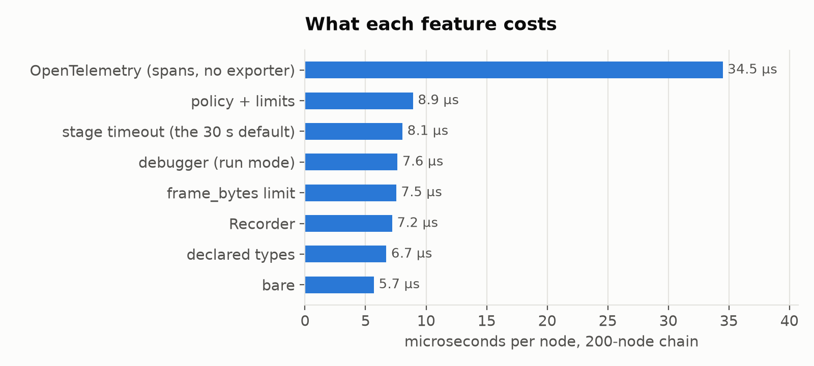
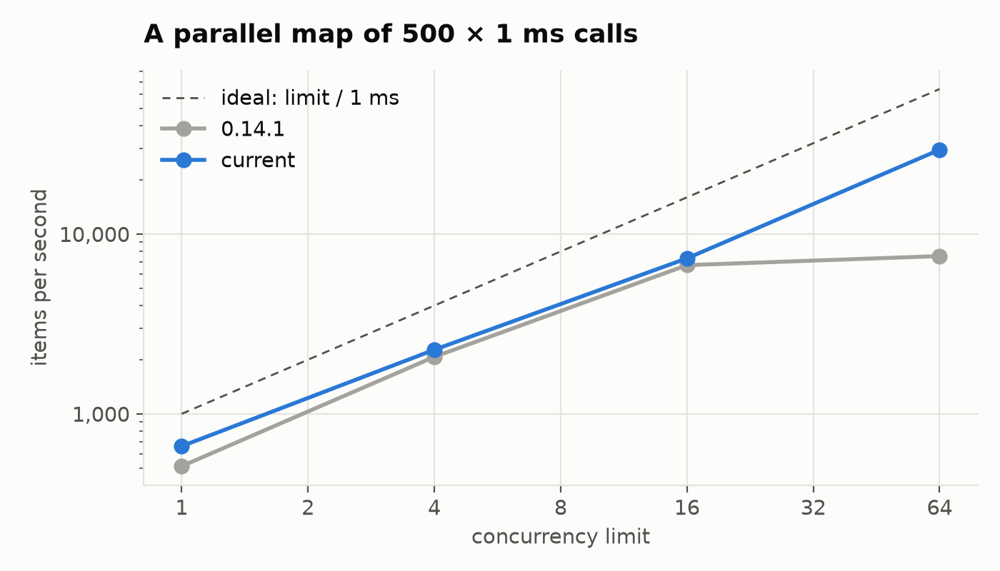
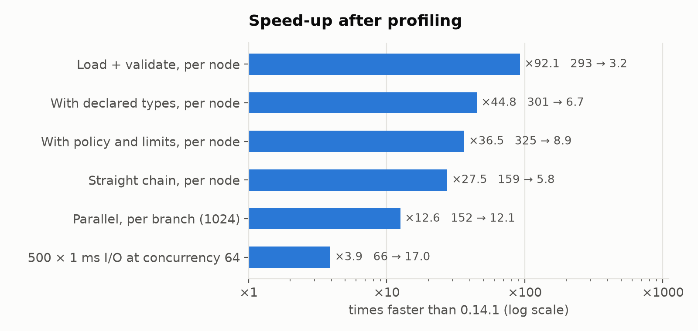

# Performance

How fast the framework itself is: walking the graph, binding arguments and
outputs, the budget, the policy — with stages that do no work of their own.
The suite and its full results are in
[`benchmarks/`](https://github.com/leo-need-more-coffee/stageflow/tree/main/benchmarks);
`python benchmarks/bench.py` runs it.

| | |
|---|---|
| a node on a straight chain | **5.8 µs** — 172 000 nodes a second |
| the same, with a policy and limits | 8.9 µs |
| one `map` iteration | 8–9 µs sequential, 11–13 µs parallel |
| a write into the frame | 0.3–0.5 µs, whatever its size |
| `from_dict` + `validate` | about 3 µs per node |

Against a real stage — a model call of hundreds of milliseconds, a query of a
few — this is noise. The framework is not the bottleneck.

## What each feature costs

A policy, limits, declared types, the debugger and the in-memory `Recorder`
each add one to three microseconds per node. OpenTelemetry adds about 28 µs —
the cost of creating a real span per node in the SDK.

## Concurrency

A parallel `map` over 500 one-millisecond calls stays within a factor of two
of the ideal throughput at every `concurrency` limit.

## How it got here

The first run of the benchmarks measured 160 µs per node. Profiling found the
causes — a stage's docstring re-parsed as YAML on every validation and every
stage run, two tasks per node in the main loop, a task per stage for its
timeout, JSON Schema evaluating nine conditional branches per node (valid
documents are now checked by the Rust `jsonschema-rs`), and a
recursive cycle check that failed on graphs of about a thousand nodes. After
the fixes:

