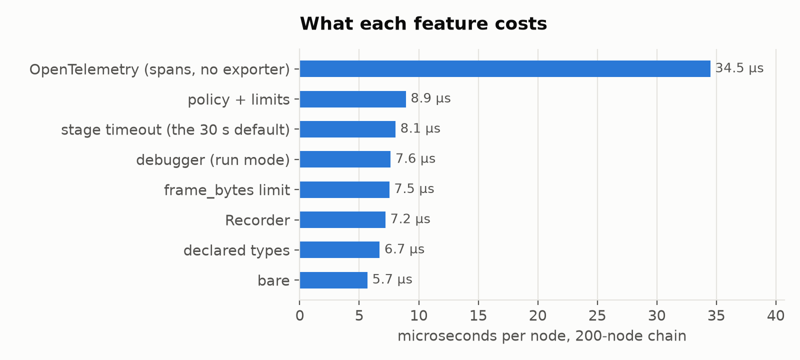
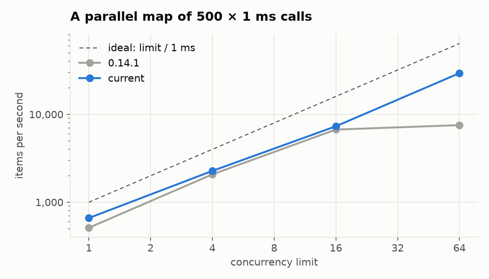
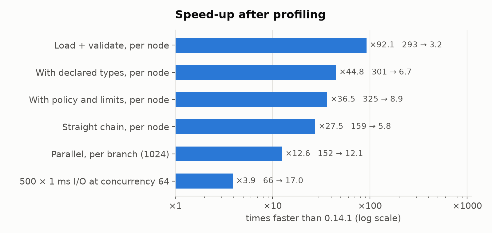

# Производительность

Насколько быстр сам фреймворк: обход графа, связывание аргументов и выходов,
бюджет, политика — на стадиях, которые сами ничего не делают. Набор
бенчмарков и полные результаты лежат в
[`benchmarks/`](https://github.com/leo-need-more-coffee/stageflow/tree/main/benchmarks);
запуск — `python benchmarks/bench.py`.

| | |
|---|---|
| узел на прямой цепочке | **5,8 мкс** — 172 000 узлов в секунду |
| то же с политикой и лимитами | 8,9 мкс |
| одна итерация `map` | 8–9 мкс последовательно, 11–13 мкс параллельно |
| запись во фрейм | 0,3–0,5 мкс при любом размере фрейма |
| `from_dict` + `validate` | около 3 мкс на узел |

На фоне настоящей стадии — вызова модели за сотни миллисекунд, запроса к базе
за единицы — это шум. Узкое место не во фреймворке.

## Сколько стоит каждая возможность

Политика, лимиты, объявленные типы, отладчик и `Recorder` добавляют по одной–
три микросекунды на узел. OpenTelemetry — около 28 мкс: столько SDK тратит на
создание настоящего спана на каждый узел.

## Конкурентность

Параллельный `map` из 500 миллисекундных вызовов держится в пределах двух раз
от идеальной пропускной способности при любом лимите `concurrency`.

## Как к этому пришли

Первый прогон бенчмарков показал 160 мкс на узел. Профилирование нашло
причины: YAML из докстринга стадии разбирался заново при каждой валидации и
каждом запуске стадии, главный цикл создавал по две задачи на узел, таймаут
стадии стоил отдельной задачи, JSON Schema проверяла по девять условных веток
на каждый узел (теперь валидные документы проверяет `jsonschema-rs` на Rust),
а рекурсивная проверка циклов падала на графах примерно из тысячи узлов. После исправлений:

