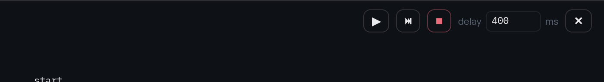

# Session control

```python
session.stop(); session.pause(); session.resume()
await session.input("command", {"name": "skip"})
```

User input: a stage declares `allowed_inputs` and awaits
`await self.wait_input("user_input", timeout=...)`; input is delivered from
outside with `await session.input("user_input", {...})`. The payload is
validated against the `payload_schema` from the declaration.

Snapshots: `session.snapshot()` returns a dict, and
`Session.from_snapshot(snap, policy=...)` restores the session; `run()` resumes
from the saved node, with the frame as it was when the snapshot was taken.

```python
snap = session.snapshot()                       # stored, sent, kept
restored = Session.from_snapshot(snap, policy=policy_of(tenant))
result = await restored.run()
```

`policy` is required, and it is not part of the snapshot. A snapshot is data —
stored, passed around, possibly edited — and an allowance read back out of data
is one the data can widen, so the host says again what the session may do.
`OPEN` is a valid answer, but it has to be given. `limits=` overrides the
policy's limits, as on `Session`. What the run has **spent** does travel: the
snapshot carries `meters`, and the restored session goes on from them, so
stopping and restoring is not a way to a fresh allowance.

The node the snapshot names is run again from its start: a snapshot taken
while a stage was running resumes before that stage, not halfway through it.

A snapshot is the raw material; for a run that waits for a person for days,
the [`wait` node](wait-node.md) with a store does the saving, the restoring
and the locking between processes for you.

The same commands are buttons in the editor's debug panel: continue, one step,
stop, and the pause between nodes.



