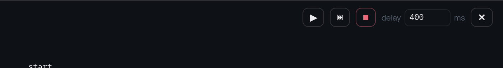

# Управление сессией

```python
session.stop(); session.pause(); session.resume()
await session.input("command", {"name": "skip"})
```

Пользовательский ввод: стадия объявляет `allowed_inputs` и ждёт
`await self.wait_input("user_input", timeout=...)`; снаружи ввод подаётся через
`await session.input("user_input", {...})`. Payload проверяется по
`payload_schema` из объявления.

Снапшоты: `session.snapshot()` возвращает dict, а
`Session.from_snapshot(snap, policy=...)` восстанавливает сессию; `run()`
продолжает с сохранённого узла, с фреймом таким, каким он был в момент снапшота.

```python
snap = session.snapshot()                       # сохранили, отправили, храним
restored = Session.from_snapshot(snap, policy=policy_of(tenant))
result = await restored.run()
```

`policy` обязательна и в снапшот не входит. Снапшот — это данные: его хранят,
передают, могут и отредактировать, а разрешение, прочитанное из данных, данные
же могут и расширить, поэтому хост заново говорит, что сессии можно. `OPEN` —
допустимый ответ, но его надо дать явно. `limits=` переопределяет лимиты
политики, как и у `Session`. А вот **потраченное** едет вместе со снапшотом:
в нём есть `meters`, и восстановленная сессия продолжает с них, так что
остановить и восстановить — не способ получить свежий бюджет.

Узел, на котором сделан снапшот, выполняется заново с начала: снапшот, снятый
посреди стадии, продолжится перед этой стадией, а не с её середины.


Те же команды — кнопки в панели отладки редактора: продолжить, шаг, стоп и
пауза между узлами.


